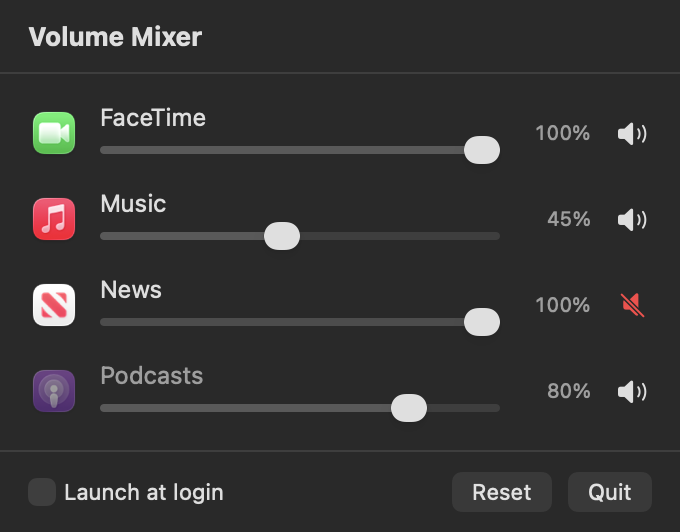
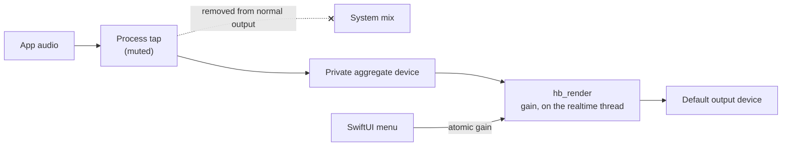

# Hushbar

[](https://github.com/ogulcanhq/hushbar/actions/workflows/ci.yml)
[](LICENSE)


A per-app volume mixer for the macOS menu bar. macOS only has one volume for everything, so a
game, a call and a browser tab can't be balanced against each other. Hushbar mutes or lowers each
app on its own, with no audio driver to install.



<sub>Rendered with sample data by the `--snapshot` diagnostic.</sub>

## Features

- Mute or lower any app that uses audio, with settings remembered per app
- Browser and Electron helper processes grouped under the app they belong to
- Apps at their default setting are left completely untouched
- No kernel extension or virtual audio device
- English and Turkish interface

## Install

Hushbar is distributed as source. You need macOS 14.2 or later and Xcode.

```sh
git clone https://github.com/ogulcanhq/hushbar.git
cd hushbar
./scripts/build.sh --install   # builds and copies to /Applications
open /Applications/Hushbar.app
```

Click the sliders icon in the menu bar. macOS asks for the **System Audio Recording** permission the
first time you adjust an app. Without it muting still works, but volume sliders have no effect.

Hushbar has to keep running for its settings to apply, so turn on **Launch at login** in its menu.
Quit Hushbar and every app goes back to normal volume.

The default ad-hoc signature changes on every build, so macOS asks for the permission again after a
rebuild. To avoid that, set `HUSHBAR_SIGN_IDENTITY` to your own signing identity when building.

## Privacy

macOS calls the permission "recording" because of the API involved, so here is exactly what happens:
each adjusted app's audio passes through memory on its way to your speakers. It is never written to
disk, and Hushbar makes no network connections. The realtime path is about 130 lines in
[`hushbar_dsp.c`](Sources/CHushbarDSP/hushbar_dsp.c) if you'd like to check.

## How it works



For each adjusted process, Hushbar creates a [Core Audio process tap](https://developer.apple.com/documentation/coreaudio/capturing-system-audio-with-core-audio-taps)
that takes its audio out of the normal mix, then plays that audio back through a private aggregate
device at the chosen gain. Taps and aggregates are private to Hushbar's process, so the system removes
them when it exits.

| Path | Responsibility |
| --- | --- |
| `Sources/CHushbarDSP` | Realtime rendering, in C |
| `Sources/Hushbar/ProcessRoute.swift` | One process's tap, aggregate device and audio callback |
| `Sources/Hushbar/HushbarModel.swift` | Tracks processes and output changes, reconciles routes |
| `Sources/Hushbar/AppIdentity.swift` | Maps an audio process to the app the user recognizes |
| `Sources/Hushbar/Diagnostics.swift` | Command-line checks of the audio path, in diagnostic builds only |

### Design decisions

- **Realtime code is in C.** The audio callback can't allocate, take a lock or wait on the Swift
  runtime without risking audible dropouts. A small C target using `stdatomic` makes that easy to
  check, and gain is the only state shared with the UI.
- **Taps rather than a virtual driver.** A driver needs an installer and has to become the system's
  default output. Taps need neither, at the cost of requiring macOS 14.2.
- **Nothing happens by default.** An app at 100% has no tap at all, so Hushbar adds no latency or CPU
  cost until you adjust something, and stops the audio thread while an adjusted app is idle.
- **Failing safe.** Without the capture permission a tap delivers silence. Hushbar skips partial-volume
  routes in that case, because silently muting an app you asked to lower would be worse than doing
  nothing.
- **Clicks and loudness.** Gain changes ramp across one buffer to avoid clicks, and the slider is
  squared so it tracks perceived loudness rather than amplitude.

### Found along the way

- `kAudioProcessPropertyIsRunningOutput` is readable but, in testing on macOS 26.5, sent no change
  notifications. `kAudioProcessPropertyIsRunning` does, so Hushbar listens to that and polls routed
  processes once a second for the case it can't see: an app already using the mic starting playback.
- Browsers play audio from helper processes, and Safari's lives in a WebKit XPC service that isn't
  under the app in the process tree. Hushbar resolves these with the process's responsible PID.
- A throwing Swift `init` still runs `deinit` once every stored property is set, so cleaning up in a
  `catch` as well freed resources twice. A regression test covers that path.

## Testing

```sh
swift test
```

Unit tests cover rendering (stream layouts, ramps, mic streams in the input list), the gain curve,
when a route is created, how processes fold into rows, and failed route setup.

The audio path needs real hardware and the permission, so `--probe` measures it directly. It routes
one process and prints peak levels before and after gain:

```sh
./scripts/build.sh --diagnostics
afplay -v 0.03 tone.wav &
open -W -n build/Hushbar.app --stdout /tmp/out.txt --args --probe $! 0.25 3
```

Measured with a test tone on macOS 26.5, Apple silicon, built-in speakers:

| Requested gain | Input peak | Output peak |
| --- | --- | --- |
| 0.25 | 0.01465 | 0.00366 |
| 0 (muted) | 0.01465 | 0 |

`--list` shows audio processes and the app each resolves to, and `--rows <seconds>` prints the menu's
rows live. Run these through `open` as above, since macOS grants the permission to the app bundle.

These commands exist only in diagnostic builds. In a normal build they would let any local program
use the app's audio permission and change other apps' volume, so they are compiled out, and the
build script refuses to install a diagnostic build. Normal builds also enable the hardened runtime,
which stops other programs injecting code to borrow the permission.

## Limitations

- Tested only on macOS 26.5 on Apple silicon.
- It relies on two private APIs that a macOS update could change: TCC to read the permission state, and
  `responsibility_get_pid_responsible_for_pid` to find the app behind a helper. It can't ship on the
  Mac App Store for the same reason.
- Audio always plays back through the default output, so an app that targets a specific device moves
  to the default one while adjusted.
- Stereo only: audio goes to the output's first two channels, which may be wrong on multichannel
  interfaces.
- An app appears in the list only after it first connects to the audio system, usually when it first
  plays a sound.
- A muted app stays muted across restarts, including one you might rely on for alerts. **Reset** in the
  menu clears every setting.

## License

[MIT](LICENSE)
